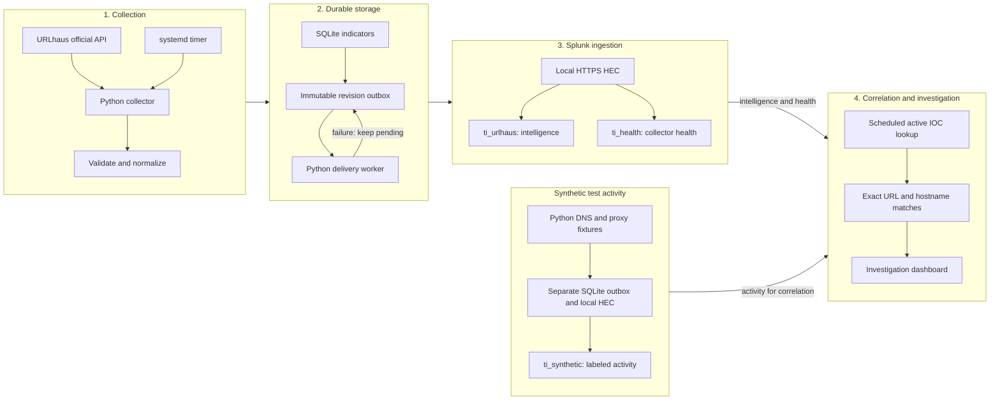
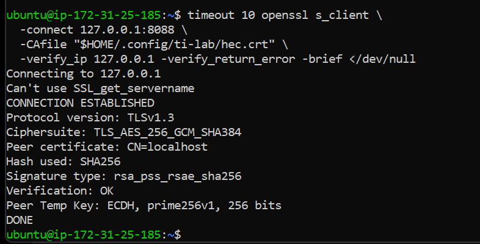
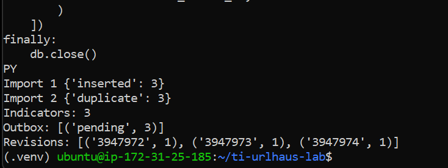
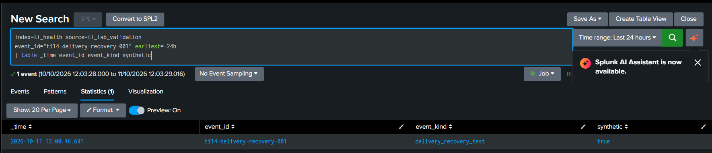
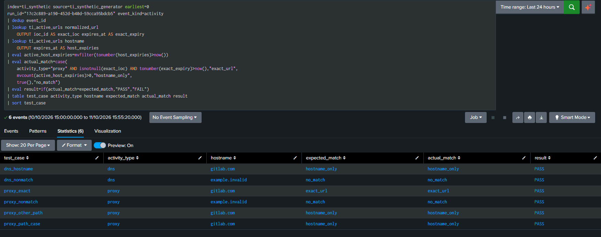
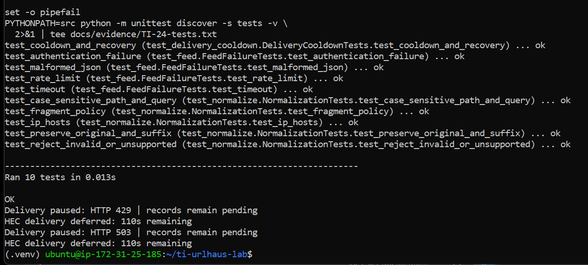

<p align="center">
  <a href="#lab-at-a-glance"></a>
</p>

<p align="center">
  <a href="src/feed.py"></a>
  <a href="src/collector.py"></a>
  <a href="src/storage.py"></a>
  <a href="splunk/README.md"></a>
  <a href="docs/03-validation.md"></a>
  <a href="docs/05-operations-and-cleanup.md"></a>
</p>

<p align="center">
<strong>A hands-on SOC engineering lab: retrieve threat intelligence through the official URLhaus API, preserve and normalize indicators, commit revisioned records and delivery state to SQLite, ingest through certificate-verified Splunk HEC, and investigate matches against six clearly labeled synthetic DNS and proxy events.</strong>
</p>

<p align="center">
<a href="#lab-at-a-glance">Lab at a Glance</a> ·
<a href="#architecture">Architecture</a> ·
<a href="#environment">Environment</a> ·
<a href="#collection">Collection</a> ·
<a href="#delivery">Delivery</a> ·
<a href="#correlation">Correlation</a> ·
<a href="#validation">Validation</a> ·
<a href="#scope">Scope</a> ·
<a href="#repository-map">Repo Map</a>
</p>

---

<a id="lab-at-a-glance"></a>
## 🎯 Lab at a Glance

This project answers a practical SOC question: **has a monitored device communicated with a destination reported as malicious?** The lab validates that workflow using synthetic activity while retaining the source context needed for an analyst to investigate a match.

| | |
|---|---|
| **Intelligence source** | URLhaus official API, authenticated with an Auth-Key |
| **Collector** | Python: validation, normalization, persistence and HEC delivery |
| **Storage** | SQLite: current indicators, immutable revision payloads, delivery state and run history |
| **SIEM integration** | Local HTTPS HEC → `ti_urlhaus`, `ti_health` and `ti_synthetic` |
| **Matching logic** | Latest revision, active expiry window, exact URL versus hostname association |
| **Activity dataset** | 6 synthetic DNS/proxy cases, explicitly labeled `synthetic=true` |
| **Correlation result** | ✅ 1 exact URL, 3 hostname-only and 2 nonmatches; all expected results passed |
| **Automated validation** | ✅ 10 test methods passed, including mocked API/HEC failure handling |
| **Operational validation** | ✅ Pending-event recovery and searchable ingestion after an EC2 reboot |
| **Access controls** | Loopback-only Splunk listeners; SSH tunnel; HEC certificate verification |
| **Budget model** | AWS credit-funded usage; Splunk Free; no paid API or AI subscription |

**A match starts an investigation; it does not automatically prove compromise.** DNS queries alone do not establish an HTTP connection, payload download or execution.

---

<a id="architecture"></a>
## 🧭 Pipeline Architecture



The operational flow is **collect → validate → persist → deliver → correlate → investigate**. SQLite stores retry state; Python performs retries. Intelligence, health and synthetic activity remain distinct in Splunk.

[Engineering decisions →](docs/02-engineering-decisions.md) · [Setup guide →](docs/01-setup.md)

---

<a id="environment"></a>
## 🖥️ Environment and Secure Access

One Ubuntu EC2 server hosts the collector, SQLite and Splunk. Only SSH is permitted inbound from the administrator's public IP. Splunk Web, HEC and management listeners are bound to `127.0.0.1`; Web is reached through an SSH tunnel.

| Component | Demonstrated configuration |
|---|---|
| EC2 | `m7i-flex.large` · 2 vCPU · 8 GiB RAM · us-east-1 |
| Storage | 30 GiB encrypted gp3 EBS |
| OS and Python | Ubuntu 26.04 LTS · Python 3.14.4 · virtual environment |
| SQLite | 3.46.1 |
| Splunk | Enterprise 10.6.0.5 software switched to the Free license |
| Collection / lookup schedule | Every 30 minutes / every 5 minutes |
| IOC expiry policy | 24 hours from collection |

<p align="center">
  <a href="screenshots/01-hec-tls-verification.png"></a>
  <br><em>HEC certificate trust and IP validation: OpenSSL returned <strong>Verification: OK</strong>.</em>
</p>

**Cost boundary:** AWS usage consumes eligible credits; it is not permanently free. Check plan status, credits and expiry before restarting or provisioning. EBS storage continues charging while EC2 is stopped. Splunk Free's authentication and alerting restrictions are accounted for in the access and scheduling design.

[Environment setup →](docs/01-setup.md) · [Cost control and cleanup →](docs/05-operations-and-cleanup.md)

---

<a id="collection"></a>
## 🔎 Intelligence Collection and Normalization

The collector retrieves a small dataset from one supported URLhaus API endpoint. It loads authentication from a private file, applies connection/read timeouts, validates the response structure and persists cooldown deadlines for controlled retries.

| Preserved context | Purpose |
|---|---|
| Source and source record ID | Trace the indicator to its provider record |
| Original URL and provider metadata | Retain the exact value and source evidence |
| Normalized URL and hostname | Support explicit URL/hostname matching |
| Provider date and status | Keep provider context distinct from local freshness |
| Collection time, expiry and revision | Track when the lab learned the indicator and which version it used |

**Normalization preserves meaningful URL components.** Scheme and authority are lowercased; path/query case, ordering and encoding remain intact. Fragments are removed from the matching value while the original URL is retained.

```text
Original:   HTTP://EXAMPLE.com:8080/Download?ID=AbC&x=%2F
Normalized: http://example.com:8080/Download?ID=AbC&x=%2F
```

This example uses a benign hostname from the unit tests. No IOC destination is visited and no payload is downloaded.

[API client](src/feed.py) · [Normalizer](src/normalize.py) · [Record validation](src/records.py) · [Normalization tests](tests/test_normalize.py)

---

<a id="delivery"></a>
## 📦 Persistent Storage and Recoverable Delivery

SQLite commits the indicator update and immutable outbox payload **in the same transaction**. A stable IOC ID identifies the source record, while each revision receives its own event ID. Retries preserve that event ID and payload.

| Delivery state | Meaning |
|---|---|
| `pending` | Python has not confirmed HEC acceptance; the payload remains available for retry |
| `accepted` | Python observed HTTP 200 with HEC `code=0` and saved that response state |

**Acceptance and indexing are separate checks.** The lab confirms events are searchable in Splunk after HEC acceptance. An ambiguous response can still create duplicate indexed events; stable IDs support SPL deduplication rather than an exactly-once guarantee.

<p align="center">
  <a href="screenshots/02-duplicate-import.png"></a>
  <br><em>Identical reimport: three inserts followed by three duplicates; original revision numbers retained.</em>
</p>

<p align="center">
  <a href="screenshots/06-recovery-searchable.png"></a>
  <br><em>Recovery verified beyond the command line: the same synthetic test event is searchable in Splunk.</em>
</p>

[Storage code](src/storage.py) · [Delivery worker](src/delivery.py) · [Pending evidence](screenshots/04-delivery-pending.png) · [Recovery state](screenshots/05-delivery-recovered.png) · [Revision history](screenshots/03-revision-history.png)

---

<a id="correlation"></a>
## 🛡️ IOC Correlation and Investigation

The active lookup selects the **latest revision before checking expiry**, preventing an older revision from resurfacing after the latest expires. Historical intelligence remains available within the database/index retention boundary.

| Match classification | Analyst interpretation |
|---|---|
| **Exact URL** | The observed normalized URL identifies the same resource as an active IOC |
| **Hostname-only** | The hostname is associated with an active URL IOC; shared-hosting and full-path context are still needed |
| **No match** | No active association was found under these rules; this is not a verdict that the activity is benign |

The six synthetic fixtures cover an exact URL, changed path case, a different path on the same host, a benign proxy URL, a matching DNS hostname and a benign DNS hostname. They are log records generated by Python, not traffic sent to the reported destinations.

<p align="center">
  <a href="screenshots/08-correlation-six-cases.png"></a>
  <br><em>All six classifications passed: one exact URL, three hostname associations and two nonmatches.</em>
</p>

### Investigation Dashboard

<p align="center">
  <a href="screenshots/10-investigation-dashboard.png"></a>
  <br><em>Collection health, synthetic classifications, exact-match context and active lookup freshness in one view.</em>
</p>

Health is recorded **before delivery**. Newly collected indicators may legitimately appear pending in that snapshot; use SQLite/journal checks for the latest queue state. Provider status and local expiry are separate facts.

[Lookup refresh](splunk/searches/refresh-active-lookup.spl) · [Correlation SPL](splunk/searches/correlation-six-cases.spl) · [Dashboard recreation](splunk/README.md) · [Investigation workflow](docs/04-investigation.md)

---

<a id="validation"></a>
## ✅ Validation and Evidence

Evidence captured during the **10–11 October 2026** lab distinguishes live checks from controlled simulations.

| Test | Verified result | Evidence |
|---|---|---|
| Identical import | 3 inserts, then 3 duplicates; revisions stayed at 1 | [Duplicate handling](screenshots/02-duplicate-import.png) |
| Controlled revision update | Revision 2, with both distinct payloads retained | [Historical payloads](screenshots/03-revision-history.png) |
| Simulated delivery unavailability | Unreachable local endpoint; event remained pending after 3 attempts | [Failure state](screenshots/04-delivery-pending.png) |
| Live HEC recovery | Same event accepted on attempt 4 and searchable in Splunk | [Accepted state](screenshots/05-delivery-recovered.png) · [Search result](screenshots/06-recovery-searchable.png) |
| Mocked API and HEC failures | 10 methods passed; authentication, rate limiting, malformed JSON, timeout and cooldown recovery tested | [Test output](docs/evidence/TI-24-tests.txt) |
| Synthetic correlation | All 6 expected classifications passed | [Correlation result](screenshots/08-correlation-six-cases.png) |
| Search-only expiry simulation | All 6 cases became nonmatches after the expiry override | [Expiry result](screenshots/09-simulated-expiry.png) |
| Free-license operation | HEC, searches, scheduling and dashboard demonstrated after migration/owner repair | [License](screenshots/11-free-license.png) · [Dashboard](screenshots/10-investigation-dashboard.png) |
| Actual EC2 reboot | Splunk and timer resumed; ports stayed on loopback | [Services](screenshots/12-reboot-services.png) |
| Post-reboot ingestion | 3 indicators + 1 health event searchable, copies=1 for each ID | [Collector run](screenshots/13-post-reboot-collector.png) · [Indexing proof](screenshots/14-post-reboot-search.png) |

<p align="center">
  <a href="screenshots/07-unit-tests.png"></a>
  <br><em>Original automated suite: HTTP failures are mocked, and cooldown recovery uses a temporary SQLite database.</em>
</p>

Re-run the suite from the repository root with the configured virtual environment:

```bash
PYTHONPATH=src python -m unittest discover -s tests -v
```

[Full validation record →](docs/03-validation.md) · [All selected screenshots →](screenshots/README.md)

---

<a id="scope"></a>
## 📋 Scope and Production Considerations

The engineering claims are bounded by the evidence. This lab demonstrates a tested core pipeline on a small controlled dataset.

| What was demonstrated | What the evidence establishes |
|---|---|
| ✅ Official API collection, validation and revisioned persistence | A working collection/storage path for the sampled records |
| ✅ Controlled pending-event failure and live recovery | The tested payload survived failure and later became searchable |
| ✅ Six synthetic correlation cases and a search-only expiry test | Matching behavior for those defined fixtures and simulated expiry values |
| ✅ Local TLS verification, loopback access and automatic reboot recovery | The tested host's access configuration and recovery behavior |
| **Latest 3 URLs per collection** | Sampling coverage; production requires broader source coverage and lifecycle updates |
| **Synthetic activity** | Logic validation; no claim of a real endpoint compromise or malware execution |
| **At-least-once delivery** | Stable IDs aid deduplication; ambiguous responses can still duplicate indexed events |
| **One host / Splunk Free** | A lab deployment; production needs appropriate identity, capacity, retention and availability controls |

Local IOC expiry is a freshness policy, not a benignness verdict. Additional validation/export/cleanup items remain tracked explicitly in the completion record; they are not represented as passed tests.

[Detailed engineering limits and production design →](docs/06-limitations-and-production.md) · [Verification and completion record →](docs/00-project-status.md)

---

<a id="repository-map"></a>
## 🗂️ Repository Map

| Path | Purpose |
|---|---|
| [`README.md`](README.md) | Project narrative, architecture, results and selected evidence |
| [`src/`](src/) | Original collector, normalization, storage, delivery and synthetic scripts |
| [`tests/`](tests/) | Automated tests with mocked HTTP failures |
| [`config/`](config/) | Nonsecret runtime example, schema and systemd units |
| [`splunk/searches/`](splunk/searches/) | Documented SPL for lookup, correlation and dashboard panels |
| [`screenshots/`](screenshots/README.md) | 14 selected screenshots, captions and provenance |
| [`docs/01-setup.md`](docs/01-setup.md) | Infrastructure, dependencies, private credentials and setup |
| [`docs/03-validation.md`](docs/03-validation.md) | Test methods, results and outstanding validation |
| [`docs/05-operations-and-cleanup.md`](docs/05-operations-and-cleanup.md) | Troubleshooting, exports, backups and cost control |
| [`docs/07-interview.md`](docs/07-interview.md) | Project walkthrough, interview preparation and truthful CV bullets |

The included SPL reconstructs documented searches. Original dashboard/app exports and a clean rebuild are tracked separately; the repository does not claim those have already been verified.

---

<p align="center">
<sub>Built by <a href="https://github.com/MUSFIRA-ZAFAR">Musfira Zafar</a> as a SOC engineering lab. Intelligence sourced through the <a href="https://urlhaus-api.abuse.ch/">official URLhaus API</a>. Activity explicitly synthetic. <a href="docs/08-references.md">Technical references</a> · <a href="docs/07-interview.md">Interview walkthrough</a>.</sub>
</p>

<p align="center">
  
</p>
