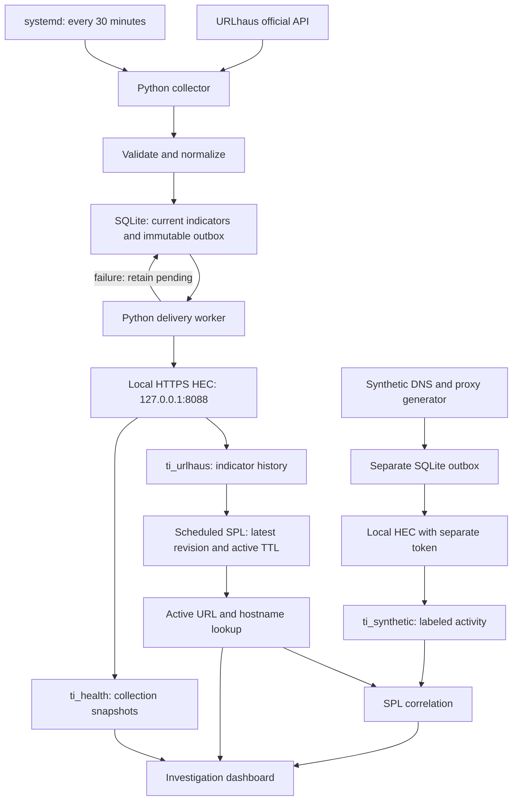
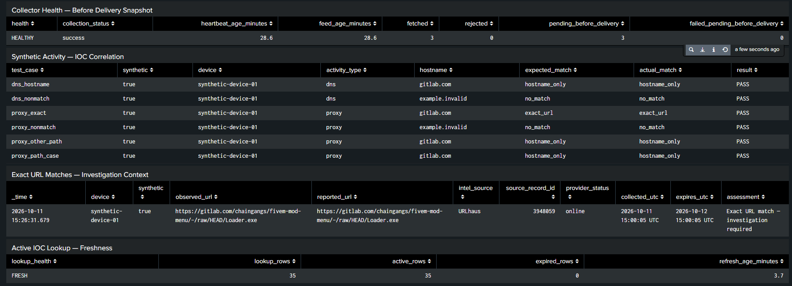

# Custom Threat Intelligence Feed & Splunk Integration

**URLhaus intelligence → durable SQLite delivery → Splunk correlation → analyst investigation**

Built by **Musfira Zafar** · SOC engineering portfolio · Lab evidence: **10–11 October 2026**

[Highlights](#project-highlights) · [Architecture](#architecture) · [Results](#demonstrated-results) · [Setup](docs/01-setup.md) · [Evidence](screenshots/README.md) · [Limits](docs/06-limitations-and-production.md)

## The operational question

> Has a monitored device communicated with a destination reported as malicious?

This lab demonstrates the workflow using **synthetic proxy and DNS events**, rather than traffic to malicious destinations. An exact URL observation provides more specific context than a hostname association. A DNS query shows a resolution attempt; it does not prove an HTTP connection or payload execution. A match starts an investigation and does not automatically prove compromise.

## Project highlights

- **Official API integration:** authenticated URLhaus collection with timeouts, response validation and persistent cooldowns.
- **Careful normalization:** retain original URLs; lowercase scheme and authority while preserving meaningful path/query case, order and encoding.
- **Durable delivery:** commit each indicator and immutable revision payload in one SQLite transaction before sending to HEC.
- **Recoverable failures:** retain pending records, attempt counts and retry deadlines across process restarts.
- **Separate acceptance from indexing:** confirm HEC responses, then search Splunk by event ID.
- **Testable correlation:** six labeled cases distinguish exact URLs, weaker hostname associations and nonmatches.
- **Investigation context:** combine original indicator, provider status, collection/expiry times, device and match specificity.
- **Restricted access:** local HTTPS HEC with certificate verification; loopback-only Splunk listeners; Web access through an SSH tunnel.
- **Automatic recovery:** verified collection and searchable ingestion after an actual EC2 reboot.

## Architecture

All components share **one Ubuntu EC2 instance**. Python creates synthetic log records; it does not visit IOC destinations or download payloads. Included SPL files reconstruct documented searches. An original exported dashboard XML is not included.

## Demonstrated results

| Validation | Observed result | Evidence |
|---|---|---|
| Identical import | 3 inserted, then 3 duplicates; revisions remained 1 | [Storage](screenshots/02-duplicate-import.png) |
| Controlled update | Revision 2 with both distinct historical payloads retained | [Revisions](screenshots/03-revision-history.png) |
| Delivery failure | Intentionally unreachable local endpoint: pending after 3 attempts | [Failure](screenshots/04-delivery-pending.png) |
| Recovery | Same event accepted on attempt 4 and searchable in Splunk | [Recovery](screenshots/05-delivery-recovered.png), [search](screenshots/06-recovery-searchable.png) |
| Automated tests | 10 methods passed; API failures and HEC cooldown/recovery mocked | [Tests](screenshots/07-unit-tests.png) |
| Synthetic correlation | 6/6 expected results: 1 exact URL, 3 hostname-only, 2 nonmatches | [Correlation](screenshots/08-correlation-six-cases.png) |
| Expiry simulation | Search-only expiry override produced 6 nonmatches | [Expiry](screenshots/09-simulated-expiry.png) |
| Free operation | Free license visible; HEC, search and dashboard worked afterward | [License](screenshots/11-free-license.png), [dashboard](screenshots/10-investigation-dashboard.png) |
| Real reboot | Splunk and timer enabled/active; all 3 listeners remained loopback | [Reboot](screenshots/12-reboot-services.png) |
| Post-reboot ingestion | Fetched 3, rejected 0, updated 3; 3 indicators + 1 health event searchable, copies=1 each | [Collector](screenshots/13-post-reboot-collector.png), [search](screenshots/14-post-reboot-search.png) |

These are case-specific observations, not throughput benchmarks, real-attack detection rates or exactly-once delivery guarantees. [Full validation record →](docs/03-validation.md)

## Investigation dashboard

The dashboard brings together collection health, expected versus actual synthetic matches, exact-match investigation context and lookup freshness. Health is captured **before delivery**: three pending records may be newly collected work, not failures. Provider status and local freshness are separate facts.

## Environment and cost boundary

| Component | Demonstrated configuration |
|---|---|
| Compute | One AWS EC2 m7i-flex.large, 2 vCPU / 8 GiB RAM, us-east-1 |
| Storage | 30 GiB encrypted gp3 EBS |
| Collector | Ubuntu 26.04 LTS; Python 3.14.4; virtual environment and Git |
| Persistence | SQLite 3.46.1; indicators, revision outbox, collection runs and cooldowns |
| SIEM | Splunk Enterprise 10.6.0.5 software, switched to Splunk Free |
| Schedule | Collector every 30 minutes; lookup refresh every 5 minutes |
| Expiry | Local policy: 24 hours from collection |

**AWS usage is credit-funded, not permanently free.** Check plan status, credits and plan expiry before restarting or provisioning. Stopping compute preserves EBS and its continuing storage charges. No earlier credit balance is presented as current. Splunk Free is a lab constraint: 500 MB/day, no user authentication or alerting; scheduled searches can maintain dashboard data. See [official references](docs/08-references.md).

## Repository guide

| Path | Purpose |
|---|---|
| `src/` | Original collector, validation, persistence, delivery and synthetic scripts |
| `tests/` | Original 10-test suite with mocked HTTP failures |
| `config/` | Nonsecret runtime settings, schema, systemd units and configuration example |
| `splunk/searches/` | Reconstructed SPL for lookup, correlation and dashboard panels |
| `screenshots/` | Selected evidence with captions and crop provenance |
| `docs/` | Setup, decisions, validation, investigation, operations and production limits |
| `docs/evidence/` | Original saved EC2 test outputs |

Start with [setup](docs/01-setup.md), then [Splunk integration](splunk/README.md). A new host needs private credentials, schema initialization, Splunk indexes/tokens/TLS configuration and an active lookup. This is not a preconfigured appliance.

## Scope, limits and project status

The demonstrated core works. Remaining completion tasks include original Splunk exports, an empty/all-expired lookup check, consistent backup/restore validation and final AWS cleanup evidence. The overnight stop was instructed, but its stopped-state screenshot was not provided.

The collector samples the **latest 3 URLs** and cannot provide complete source coverage. Expiry is a relevance policy, not proof that a URL became benign. Delivery is **at least once**: stable IDs aid search deduplication, but HEC does not automatically deduplicate this implementation. [Production differences →](docs/06-limitations-and-production.md)

## Portfolio walkthrough

“I built a Python collector that retrieves URLhaus metadata, validates URLs without changing meaningful paths or queries, and commits indicators and versioned delivery payloads to SQLite. A delivery worker sends pending payloads to local Splunk HEC with certificate verification. I verified searchable ingestion, correlated six synthetic DNS/proxy cases with active intelligence, tested retry recovery and expiry filtering, and confirmed recovery after an EC2 reboot. The lab demonstrates a small reliable workflow with documented coverage and delivery limitations.”

[Truthful CV bullets and interview preparation →](docs/07-interview.md)
